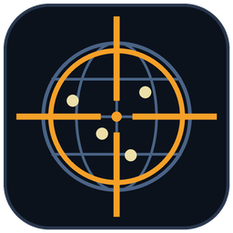

<div align="center">



# CS2 Region Picker

**Choose which Counter-Strike 2 matchmaking regions you play on — from an interactive world map.**
**Elige en qué regiones de Counter-Strike 2 quieres jugar — desde un mapa mundial interactivo.**

[](../../releases/latest)


[English](#english) · [Español](#español)

</div>

<!-- Add a screenshot at docs/screenshot.png and uncomment:
<p align="center"></p>
-->

---

## English

### What is it?
CS2 Region Picker blocks the Steam Datagram Relay IPs of the regions you do **not** want, using Windows Firewall rules, so matchmaking only finds servers where you chose to play (lower ping, no far-away matches).

It does **not** touch the game: no injection, no memory access, no file changes. It only creates firewall rules and reads Valve's public relay list. Details in [How it works](docs/HOW_IT_WORKS.md).

### Features
- 🗺️ **Interactive world map** — click a server to allow/block it, drag, zoom, hover for ping.
- 📍 **Your location, detected automatically** (or right-click the map), with dashed lines to the servers you chose.
- ⚡ **Auto: best ping** — measures every region and keeps the N fastest.
- 🌎 **Continent shortcuts** — "Only continent…" / "Add continent…".
- 🔄 **Self-updating rules** — when Valve changes relay IPs, your rules are re-applied on the next launch.
- 💾 **Persistent** — rules stay after closing the app and after rebooting.
- 🧳 **Portable** — one `.exe`, nothing to install.
- 🌐 English, Español, Português.

### Download & use
1. Download `CS2RegionPicker.exe` from [Releases](../../releases/latest).
2. Run it and accept the Administrator (UAC) prompt — needed to edit firewall rules.
3. Click the servers you want to **allow** (yellow = allowed, red = blocked) or use *Auto: best ping*.
4. Press **Apply**. You can close the program; the rules stay.
5. To undo: **Remove all blocks**.

Requirements: Windows 10/11 (.NET Framework 4.x is already included in Windows) and an internet connection.

### ⚠️ Windows warnings
The `.exe` is **not code-signed** (certificates cost money), so depending on your PC Windows may warn:
- **SmartScreen** → *More info* → *Run anyway*.
- **Smart App Control** (Windows 11) may block unsigned apps. Whether it does depends on your PC; the app cannot bypass it. Turning it off is permanent until you reinstall Windows, so think twice.
- Some antivirus products flag unsigned executables. You can check the file's **SHA-256** (shown in each release) and scan it on [VirusTotal](https://www.virustotal.com/).

Check the hash in PowerShell:
```powershell
Get-FileHash .\CS2RegionPicker.exe -Algorithm SHA256
```

### Privacy
- Auto-detecting your location sends your public IP to `ipwho.is` (fallback `ipapi.co`). Right-click the map to set it manually instead.
- Nothing else is sent anywhere. Settings stay in a local folder next to the exe.

### Uninstall
Press **Remove all blocks**, then delete the `.exe` and the `CS2RegionPicker-data` folder.
If you deleted the program first: run `netsh advfirewall firewall delete rule name=CS2-Region-Picker` in an Administrator console.

### Support
Open an [issue](../../issues) describing your Windows version, the app version and the text of the app's log.

### Disclaimer
Unofficial fan project, not affiliated with or endorsed by Valve. *Counter-Strike* and *Steam* are trademarks of Valve Corporation. Use at your own risk. With few regions allowed, finding a match may take longer. See [LICENSE](LICENSE).

---

## Español

### ¿Qué es?
CS2 Region Picker bloquea, con reglas del Firewall de Windows, las IPs del Steam Datagram Relay de las regiones que **no** quieres, para que el matchmaking solo encuentre servidores donde tú elegiste jugar (menos ping, sin partidas lejanas).

**No** toca el juego: sin inyección, sin acceso a memoria, sin modificar archivos. Solo crea reglas de firewall y lee la lista pública de relays de Valve. Detalles en [Cómo funciona](docs/HOW_IT_WORKS.md).

### Características
- 🗺️ **Mapa mundial interactivo**: clic en un servidor para permitir/bloquear, arrastrar, zoom y ping al pasar el mouse.
- 📍 **Tu ubicación detectada automáticamente** (o clic derecho en el mapa), con líneas punteadas hacia los servidores elegidos.
- ⚡ **Auto: mejor ping**: mide todas las regiones y deja las N más rápidas.
- 🌎 **Atajos por continente**: "Solo continente…" / "Agregar continente…".
- 🔄 **Reglas que se actualizan solas**: si Valve cambia las IPs de los relays, se reaplican al abrir el programa.
- 💾 **Persistente**: las reglas siguen al cerrar la app y al reiniciar el PC.
- 🧳 **Portable**: un solo `.exe`, sin instalar nada.
- 🌐 English, Español, Português.

### Descarga y uso
1. Descarga `CS2RegionPicker.exe` desde [Releases](../../releases/latest).
2. Ábrelo y acepta el aviso de Administrador (UAC): es necesario para editar el firewall.
3. Haz clic en los servidores que quieres **permitir** (amarillo = permitido, rojo = bloqueado) o usa *Auto: mejor ping*.
4. Pulsa **Aplicar**. Puedes cerrar el programa; las reglas se mantienen.
5. Para deshacer: **Quitar todos los bloqueos**.

Requisitos: Windows 10/11 (.NET Framework 4.x ya viene incluido) y conexión a internet.

### ⚠️ Avisos de Windows
El `.exe` **no está firmado** (los certificados cuestan dinero), así que según tu PC Windows puede advertir:
- **SmartScreen** → *Más información* → *Ejecutar de todas formas*.
- **Control inteligente de aplicaciones** (Windows 11) puede bloquear apps sin firma. Depende de tu PC y la app no puede evitarlo. Desactivarlo es permanente hasta reinstalar Windows, piénsalo bien.
- Algunos antivirus marcan ejecutables sin firma. Puedes comprobar el **SHA-256** del archivo (aparece en cada release) y analizarlo en [VirusTotal](https://www.virustotal.com/).

Comprobar el hash en PowerShell:
```powershell
Get-FileHash .\CS2RegionPicker.exe -Algorithm SHA256
```

### Privacidad
- Detectar tu ubicación envía tu IP pública a `ipwho.is` (alternativa `ipapi.co`). Con clic derecho en el mapa puedes fijarla a mano.
- No se envía nada más. La configuración queda en una carpeta local junto al exe.

### Desinstalar
Pulsa **Quitar todos los bloqueos** y luego borra el `.exe` y la carpeta `CS2RegionPicker-data`.
Si borraste el programa antes: ejecuta `netsh advfirewall firewall delete rule name=CS2-Region-Picker` en una consola de Administrador.

### Soporte
Abre un [issue](../../issues) indicando tu versión de Windows, la versión de la app y el texto del registro.

### Aviso legal
Proyecto de fans, no oficial, sin relación ni respaldo de Valve. *Counter-Strike* y *Steam* son marcas de Valve Corporation. Úsalo bajo tu responsabilidad. Con pocas regiones permitidas, encontrar partida puede tardar más. Ver [LICENSE](LICENSE).

---

## Author / Autor

**Jose Perea** — [GitHub](https://github.com/josefperea) · [LinkedIn](https://www.linkedin.com/in/josefperea/)

© Jose Perea — Freeware, [LICENSE](LICENSE)
